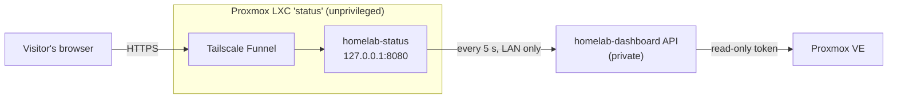

# homelab-status

A tiny, read-only status API for my Proxmox homelab. It powers the live "My lab, live."
section on [jonesthala.ch](https://jonesthala.ch): host uptime, CPU and RAM, every container
with its LED, a heartbeat on each answer and a ping button that measures the round trip
from your browser to the server in my home.



## Endpoints

| Path | What it returns |
| --- | --- |
| `GET /v1/status` | `host`, `uptime_s`, `cpu`, `mem`, `hw`, `cpu_history`, `guests[]`, `running`, `total`, plus `ok` (data fresher than 30 s), `now` and `updated` |
| `GET /v1/ping` | `{"pong": true}` with the server time, never cached |

Everything else is a 404, and every method except GET, HEAD and OPTIONS gets a 405.

## Security

The endpoint is public, so it is built to give away as little as possible:

- **Read-only by design.** It only reads a private dashboard API on the LAN. There is no code
  path that could start, stop or change anything.
- **Whitelisted output.** The snapshot is rebuilt field by field: no IPs, no kernel or Proxmox
  versions, no storage layout. Container names are reduced to `[a-z0-9-]`.
- **Cached.** Requests are answered from memory, so many visitors never reach Proxmox.
- **Rate limited.** Token buckets per client and in total, plus a cap on open connections.
- **No access log.** Visitors' addresses are not stored.
- **Fenced in.** The container's own nftables rules allow the internet (Tailscale), DNS on the
  router and the dashboard API, and drop everything else on the home network
  ([`deploy/nftables.conf`](deploy/nftables.conf)). Tailscale runs in userspace mode, so the
  container has no network route into my tailnet either.
- **Hardened service.** `DynamicUser`, read-only file system, no capabilities, syscall filter,
  memory limit ([`deploy/homelab-status.service`](deploy/homelab-status.service)).
- CORS only allows my site's origins (and localhost for development).

## Run it

Python 3.11+, standard library only.

```bash
python homelab_status.py --demo          # generated data on 127.0.0.1:8080
UPSTREAM=http://192.168.0.206:8000 python homelab_status.py
```

Settings come from environment variables, see
[`deploy/homelab-status.env.example`](deploy/homelab-status.env.example).

## Deploy (Debian 13 LXC)

```bash
install -D -m 644 homelab_status.py /opt/homelab-status/homelab_status.py
install -m 644 deploy/homelab-status.service /etc/systemd/system/
install -m 644 deploy/homelab-status.env.example /etc/homelab-status.env
install -m 755 deploy/nftables.conf /etc/nftables.conf && systemctl restart nftables
systemctl enable --now homelab-status
# Tailscale in userspace mode, then publish only this service:
sed -i 's/^FLAGS=.*/FLAGS="--tun=userspace-networking"/' /etc/default/tailscaled && systemctl restart tailscaled
tailscale up --hostname=status --accept-dns=false
tailscale funnel --bg 8080
```

## Tests

```bash
python -m unittest discover -s tests -v
```
